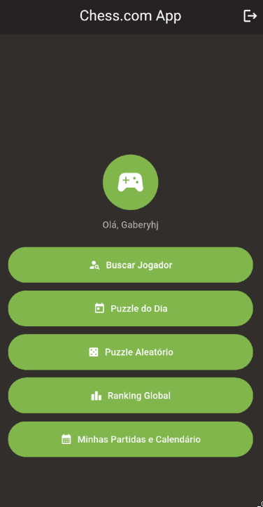
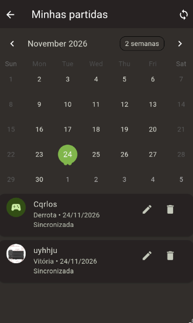
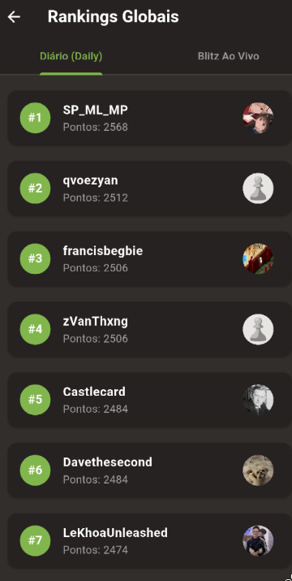
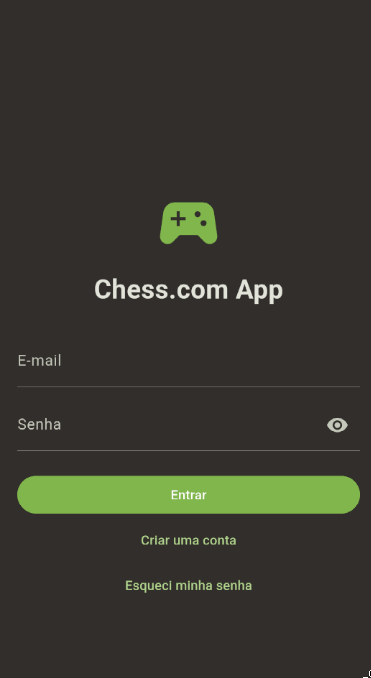

# Chess.com App

Aplicativo mobile de xadrez desenvolvido com **Flutter** como trabalho final da disciplina.

## Telas do aplicativo

### Tela inicial


### Minhas partidas e calendário


### Rankings globais


### Login


## Funcionalidades

- Login e autenticação de usuários.
- Criação de conta e recuperação de senha.
- Busca de jogadores.
- Puzzle do dia e puzzle aleatório.
- Ranking global.
- Registro e gerenciamento de partidas.
- Calendário para visualizar as partidas por data.
- Armazenamento local e suporte ao uso offline, com sincronização quando a conexão retorna.
- Registro de localização por GPS nas partidas.
- Seleção de imagens da galeria.

## Tecnologias

- Flutter
- Dart
- Firebase Authentication
- Cloud Firestore
- SQLite
- Geolocator
- Image Picker
- Table Calendar
- API do chess.com

## Como executar

1. Instale o [Flutter](https://docs.flutter.dev/get-started/install) e configure o ambiente Android.
2. Clone este repositório:
   ```bash
   git clone https://github.com/AqueleTaldoGabo/xadrezFinal.git
   ```
3. Entre na pasta do projeto:
   ```bash
   cd xadrezFinal
   ```
4. Instale as dependências:
   ```bash
   flutter pub get
   ```
5. Configure o Firebase para seu próprio projeto usando o FlutterFire CLI. O arquivo `firebase_options.dart` deve corresponder ao projeto Firebase configurado.
6. Execute o aplicativo:
   ```bash
   flutter run
   ```

## Gerar APK

Para gerar a versão de lançamento para Android:

```bash
flutter build apk --release
```

O APK será gerado em:

```text
build/app/outputs/flutter-apk/app-release.apk
```

## Integrantes

- Christian Dziurza Carneiro
- Gabriel Kremer Schultz

